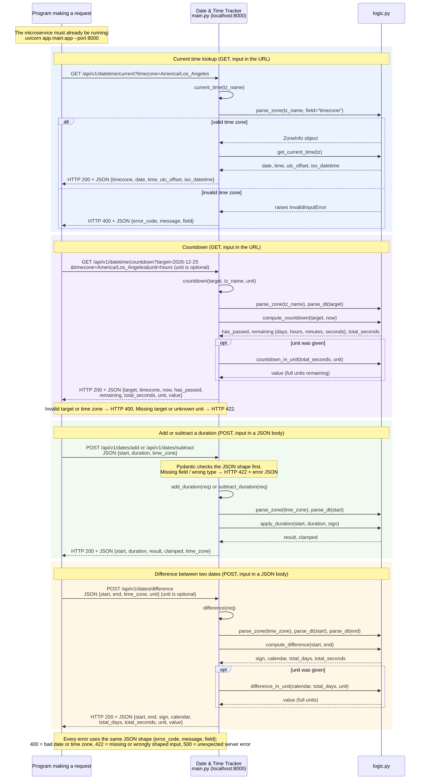

# Date and Time Tracker Microservice

A microservice that handles date and time work for other programs, so they don't have to write their own date or time zone logic. It can:

- **Look up the current date and time** in any time zone.
- **Count down to a future date**: the time remaining in days, hours, minutes and seconds, or as a total in one unit.
- **Add or subtract** an amount of time (years, months, days, hours, minutes, seconds) to or from a date. The math follows calendar rules, including leap years.
- **Calculate the difference** between two dates, both in calendar terms (years, months, days) and as totals (days and seconds). Optionally, it can also give the difference in one chosen unit: days, weeks, months or years.

Other programs talk to it over **HTTP**, sending and receiving **JSON**. Any language that can make an HTTP request can use it.

---

## Communication Contract

| | |
|---|---|
| **Communication pipe** | REST API over HTTP |
| **Address** | `http://localhost:8000` |
| **Data format** | JSON (both requests and responses) |
| **Dates** | ISO 8601: `YYYY-MM-DD` (e.g. `2026-11-16`) or `YYYY-MM-DDTHH:MM:SS` (e.g. `2026-11-16T09:30:00`) |
| **Time zones** | IANA names (e.g. `America/Los_Angeles`, `Europe/London`). Defaults to `UTC` if left out. |

| Endpoint | Method | Purpose |
|---|---|---|
| `/api/v1/datetime/current` | GET | Current date and time in a time zone |
| `/api/v1/datetime/countdown` | GET | Time remaining until a future date |
| `/api/v1/dates/add` | POST | Add a duration to a date |
| `/api/v1/dates/subtract` | POST | Subtract a duration from a date |
| `/api/v1/dates/difference` | POST | Difference between two dates |
| `/health` | GET | Check that the microservice is running |

---

## How to Run the Microservice

Requires Python 3.10 or newer.

```bash
# 1. Create and activate a virtual environment (one time)
python -m venv .venv
.venv\Scripts\activate          # Windows
source .venv/bin/activate       # macOS / Linux

# 2. Install the dependencies (one time)
pip install -r requirements.txt

# 3. Start the microservice
uvicorn app.main:app --port 8000
```

Leave it running. Interactive documentation is available at `http://localhost:8000/docs`.

To see every endpoint in action, run the test program in a second terminal:

```bash
python demo_client.py
```

---

## How to REQUEST Data

Send an HTTP request to the microservice's address.

- **GET** requests (current time, countdown, health) put their input in the URL's query string.
- **POST** requests (add, subtract, difference) put their input in a JSON body. They must include the header `Content-Type: application/json`.

### 1. Current date and time: `GET /api/v1/datetime/current`

| Parameter | In | Required | Description |
|---|---|---|---|
| `timezone` | query string | No (default `UTC`) | IANA time zone name |

Example request: `GET http://localhost:8000/api/v1/datetime/current?timezone=America/Los_Angeles`

### 2. Countdown: `GET /api/v1/datetime/countdown`

| Parameter | In | Required | Description |
|---|---|---|---|
| `target` | query string | Yes | The ISO 8601 date or datetime to count down to. A date alone (e.g. `2026-12-25`) means midnight at the start of that day. |
| `timezone` | query string | No (default `UTC`) | IANA time zone used for a `target` that has no UTC offset |
| `unit` | query string | No | `days`, `hours`, `minutes` or `seconds`. Also gives the time remaining as a total in this unit. |

Example request: `GET http://localhost:8000/api/v1/datetime/countdown?target=2026-12-25&timezone=America/Los_Angeles&unit=hours`

### 3. Add or subtract: `POST /api/v1/dates/add` and `POST /api/v1/dates/subtract`

| Field | Type | Required | Description |
|---|---|---|---|
| `start` | string | Yes | ISO 8601 date or datetime |
| `duration` | object | Yes | Any of `years`, `months`, `days`, `hours`, `minutes`, `seconds`. Each value must be a whole number ≥ 0, and at least one must be greater than 0. Use the `/subtract` endpoint to go backwards, not negative numbers. |
| `time_zone` | string | No (default `UTC`) | IANA time zone used for a `start` that has no UTC offset |

Example body:
```json
{ "start": "2026-01-31", "duration": { "months": 1 }, "time_zone": "UTC" }
```

### 4. Difference: `POST /api/v1/dates/difference`

| Field | Type | Required | Description |
|---|---|---|---|
| `start` | string | Yes | ISO 8601 date or datetime |
| `end` | string | Yes | ISO 8601 date or datetime |
| `time_zone` | string | No (default `UTC`) | IANA time zone used for values that have no UTC offset |
| `unit` | string | No | `days`, `weeks`, `months` or `years`. Also gives the difference in this unit. |

Example body:
```json
{ "start": "2024-02-29", "end": "2026-03-01", "unit": "weeks" }
```

### Example call (Python, standard library only)

```python
import json
import urllib.parse
import urllib.request

BASE_URL = "http://localhost:8000"

# --- GET request: current time in Los Angeles ---
query = urllib.parse.urlencode({"timezone": "America/Los_Angeles"})
get_request = urllib.request.Request(
    f"{BASE_URL}/api/v1/datetime/current?{query}", method="GET"
)

# --- GET request: countdown to Christmas, also as total hours ---
query = urllib.parse.urlencode({
    "target": "2026-12-25",
    "timezone": "America/Los_Angeles",
    "unit": "hours",
})
countdown_request = urllib.request.Request(
    f"{BASE_URL}/api/v1/datetime/countdown?{query}", method="GET"
)

# --- POST request: add 1 month to January 31 ---
body = {"start": "2026-01-31", "duration": {"months": 1}}
post_request = urllib.request.Request(
    f"{BASE_URL}/api/v1/dates/add",
    data=json.dumps(body).encode("utf-8"),
    headers={"Content-Type": "application/json"},
    method="POST",
)
```

---

## How to RECEIVE Data

The microservice answers every request with an **HTTP status code** and a **JSON body**. Check the status code first, then read the JSON.

| Status | Meaning |
|---|---|
| `200` | Success. The JSON holds the result. |
| `400` | A value can't be used: an invalid date or an unknown time zone. |
| `422` | The request has the wrong shape: a missing field, a wrong type, an unknown `unit`, a negative duration, or a duration that is all zeros. |
| `500` | Unexpected server error. |

### Successful responses

**Current time** (`200`):
```json
{
  "timezone": "America/Los_Angeles",
  "date": "2026-11-16",
  "time": "16:52:03",
  "utc_offset": "-08:00",
  "iso_datetime": "2026-11-16T16:52:03-08:00"
}
```
`date` is always `YYYY-MM-DD`, and `time` is always `HH:MM:SS` on a 24-hour clock.

**Countdown** (`200`). This example asked for `unit=hours`:
```json
{
  "target": "2026-12-25",
  "timezone": "America/Los_Angeles",
  "now": "2026-11-16T17:00:00-08:00",
  "has_passed": false,
  "remaining": { "days": 38, "hours": 7, "minutes": 0, "seconds": 0 },
  "total_seconds": 3308400,
  "unit": "hours",
  "value": 919
}
```
- `remaining` is the time left, split the way a countdown clock shows it (hours 0–23, minutes and seconds 0–59).
- `unit` and `value` give the time left as a total in the requested unit. Only full units are counted. Both are `null` if no `unit` was requested.
- `has_passed` is `true` once the target has been reached. Every number is then `0`; it is not an error.
- The countdown counts real elapsed time, so it stays correct across daylight saving time changes.

**Add / subtract** (`200`):
```json
{
  "start": "2026-01-31",
  "duration": { "years": 0, "months": 1, "days": 0, "hours": 0, "minutes": 0, "seconds": 0 },
  "result": "2026-02-28",
  "clamped": true,
  "time_zone": "UTC"
}
```
- `result` is a date (`YYYY-MM-DD`) when `start` was a date. It is a full datetime with its UTC offset (e.g. `2026-11-01T14:45:00-05:00`) when `start` was a datetime.
- `clamped` is `true` when the day had to move to fit a shorter month. For example, Jan 31 + 1 month becomes Feb 28.
- For `/subtract`, the `duration` values come back negative.

**Difference** (`200`):
```json
{
  "start": "2024-02-29",
  "end": "2026-03-01",
  "sign": 1,
  "calendar": { "years": 2, "months": 0, "days": 1 },
  "total_days": 731,
  "total_seconds": 63158400,
  "unit": "weeks",
  "value": 104
}
```
- All numbers are positive. `sign` is `1` if `end` is on or after `start`, and `-1` if `end` is before `start`.
- `unit` and `value` give the difference in the requested unit. Only full units are counted (731 days is 104 full weeks). Months and years follow the calendar, so `months` would be `24` and `years` would be `2` here. Both are `null` if no `unit` was requested.

### Error responses

Every error (`400`, `422`, `500`) has the same JSON shape:
```json
{
  "error_code": "INVALID_INPUT",
  "message": "'Mars/Olympus_Mons' is not a valid IANA time zone",
  "field": "timezone"
}
```
`error_code` is one of `INVALID_INPUT` (400), `VALIDATION_ERROR` (422) or `INTERNAL_ERROR` (500). `field` names the input that caused the problem, or is `null` if the error isn't tied to one field.

### Example call (Python, standard library only)

Continuing from the request example above:

```python
import urllib.error

def send(request):
    """Send a request and return (status_code, data_as_dict)."""
    try:
        with urllib.request.urlopen(request, timeout=5) as response:
            return response.status, json.loads(response.read())
    except urllib.error.HTTPError as error:
        # 4xx and 5xx responses still carry the JSON error body.
        return error.code, json.loads(error.read())

status, data = send(get_request)
if status == 200:
    print("Date:", data["date"])      # e.g. 2026-11-16
    print("Time:", data["time"])      # e.g. 16:52:03
else:
    print("Error:", data["message"])

status, data = send(countdown_request)
if status == 200:
    left = data["remaining"]
    print(f"{left['days']} days, {left['hours']} hours left")  # e.g. 38 days, 7 hours left
    print(f"{data['value']} {data['unit']} left")             # e.g. 919 hours left

status, data = send(post_request)
if status == 200:
    print("Result:", data["result"])  # 2026-02-28
```

---

## UML Sequence Diagram



The diagram's source is in `docs/sequence-diagram.mmd` (Mermaid format).

---

## Project Files

| File | Purpose |
|---|---|
| `app/main.py` | Creates the web app, defines the endpoints and handles errors |
| `app/logic.py` | The date and time calculations |
| `app/models.py` | The shapes of the request and response JSON |
| `app/middleware.py` | Adds an `X-Process-Time-Ms` header with the processing time to every response |
| `demo_client.py` | Test program that calls every endpoint and prints the results |
| `tests/test_api.py` | Automated tests (run with `python -m pytest`) |
| `docs/openapi.yaml` | Full API specification (OpenAPI 3) |
| `docs/sequence-diagram.png` | UML sequence diagram |
